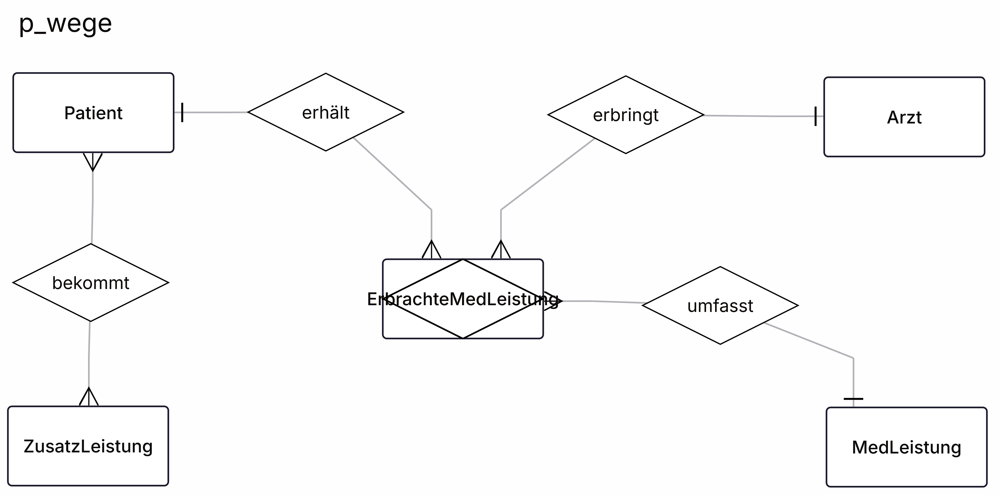
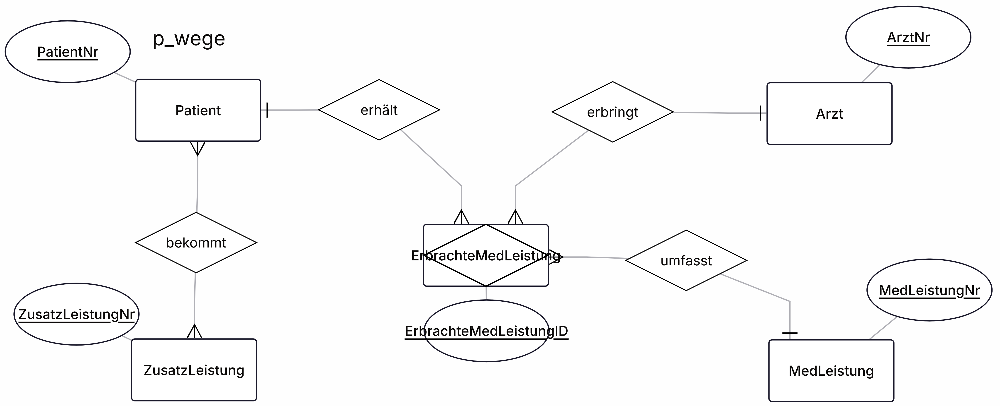
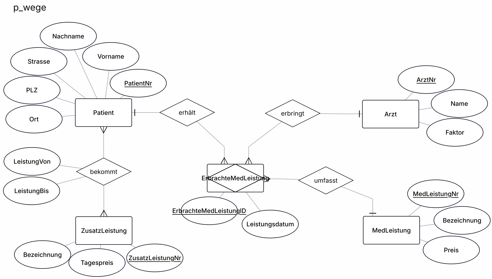
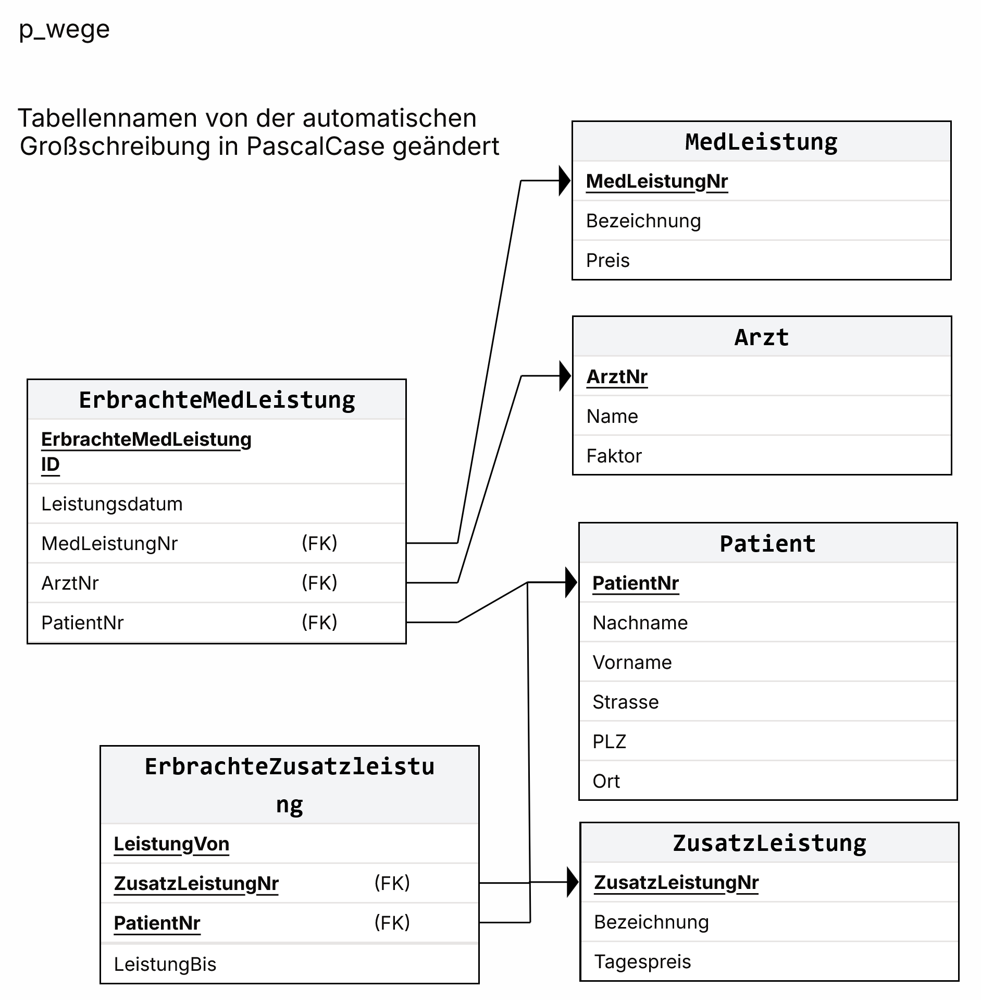

# Datenbank Klausur P_Wege – ✍️😃 Happy coding! 💯👍

## Schritt 1: ER-Modell mit Entitys, Beziehungen und Kardinalitäten

Falls es etwas undeutlich zu sehen sein sollte wegen der Überlappung der Entity und des Namens, der Name lautet: **ErbrachteMedLeistung**, das Wort verdeckt auch die Kardinalität, das ist ein *Krähenfuss*. Gleiches gilt in den Folgenden Bildern!

## Schritt 2: ER-Modell mit den Primärschlüssel-Attributen

## Schritt 3: ER-Modell mit allen weiteren Attributen

## Schritt 4: Relation Schema aus dem ER-Modell erstellt

Ich habe wie im Bild anhand des Labels zu erkennen nachträglich die Großschreibung der Tabellennamen in PascalCase geändert damit es sich mit dem ER-Modell gleicht.

