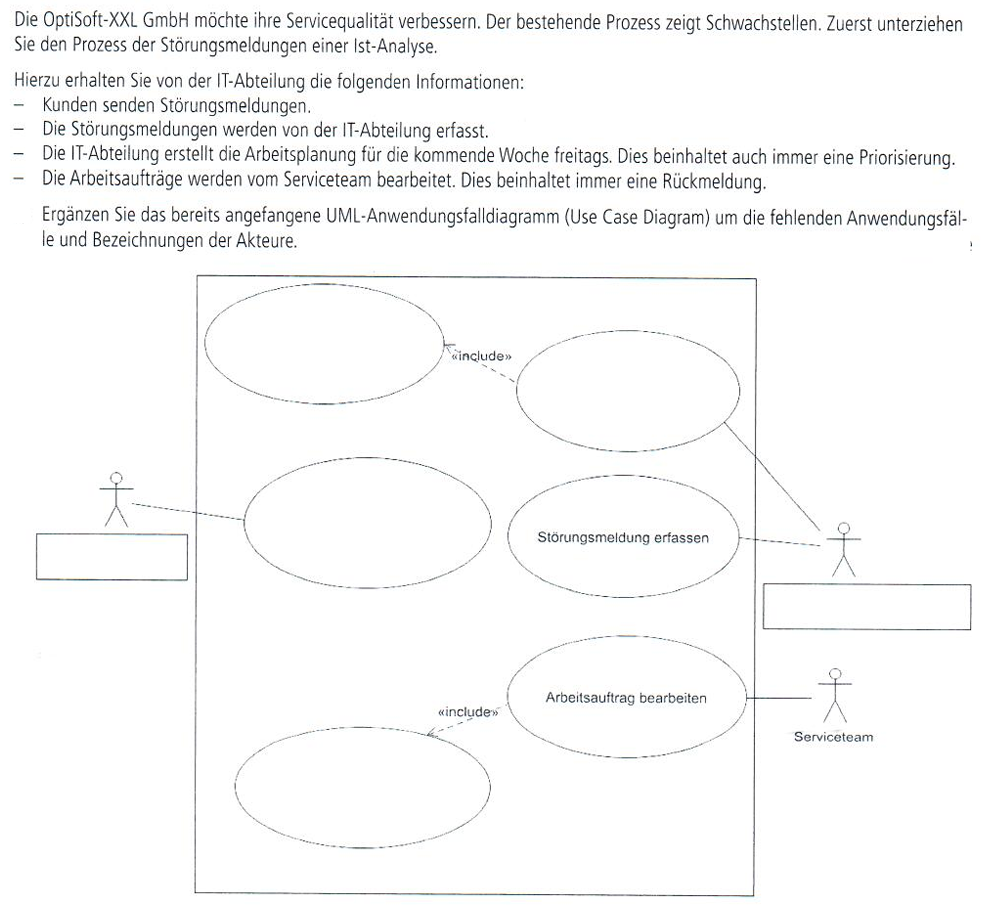
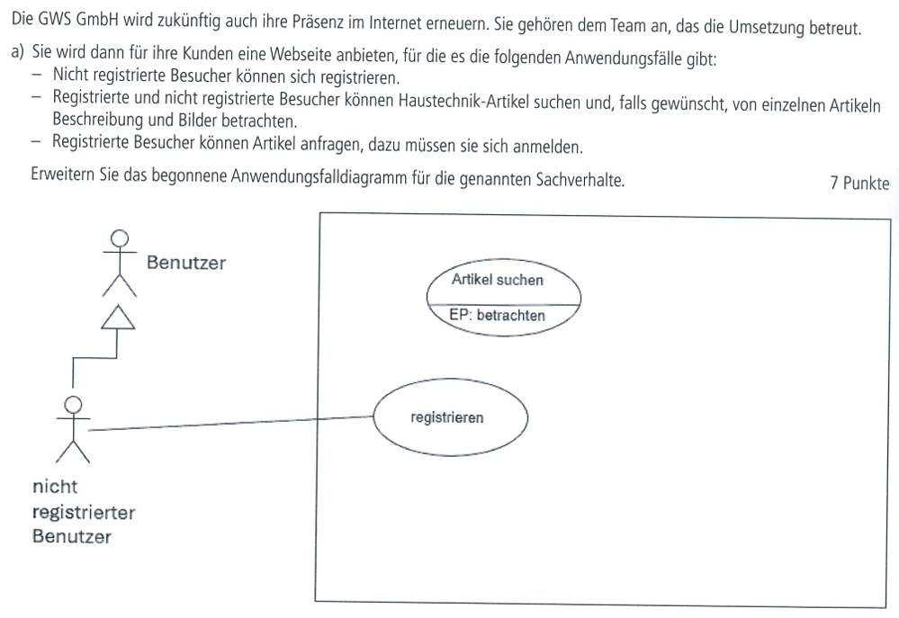
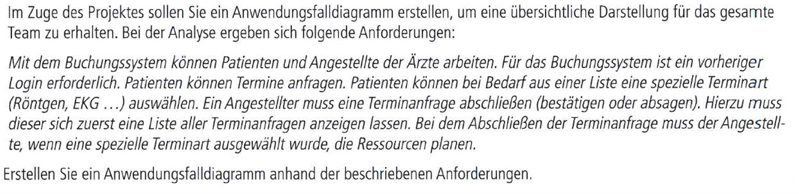
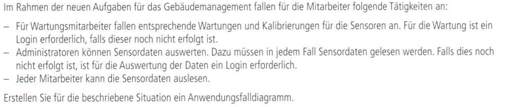
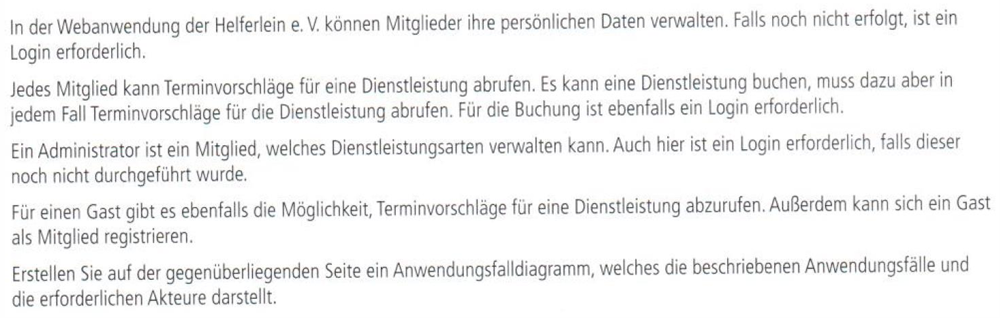
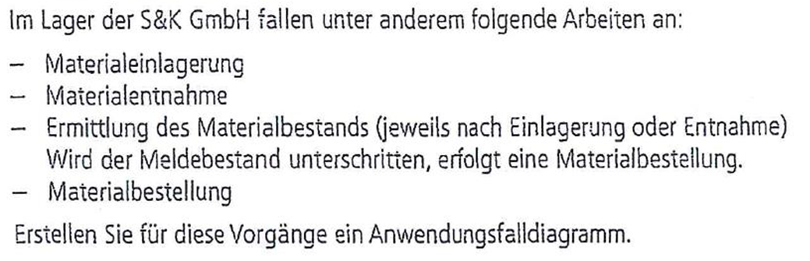

# Praxis mit Anwendungsfall-Diagrammen

## 1. Helpdesk einer IT-Abteilung

### Lösung zu 1

[Binden Sie hier das PNG Ihrer Lösung ein.]

## 2. Schließsystem einer Hausverwaltung

### Lösung zu 2

[Binden Sie hier das PNG Ihrer Lösung ein.]

## 3. Webshop für Haustechnik

### Lösung zu 3

[Binden Sie hier das PNG Ihrer Lösung ein.]

## 4. Terminbuchungssystem einer Klinik

### Lösung zu 4

[Binden Sie hier das PNG Ihrer Lösung ein.]

## 5. Sensoren im Gebäudemanagement

### Lösung zu 5

[Binden Sie hier das PNG Ihrer Lösung ein.]

## 6. Webanwendung des Helferlein Vereins

### Lösung zu 6

[Binden Sie hier das PNG Ihrer Lösung ein.]

## 7. Lagerverwaltung

### Lösung zu 7

[Binden Sie hier das PNG Ihrer Lösung ein.]
