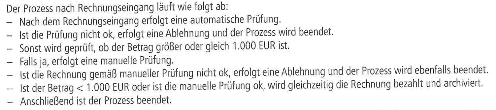
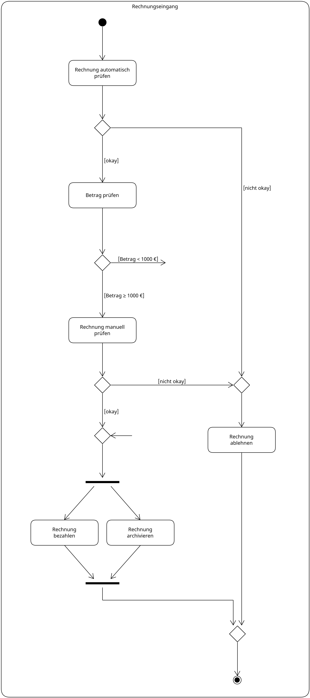
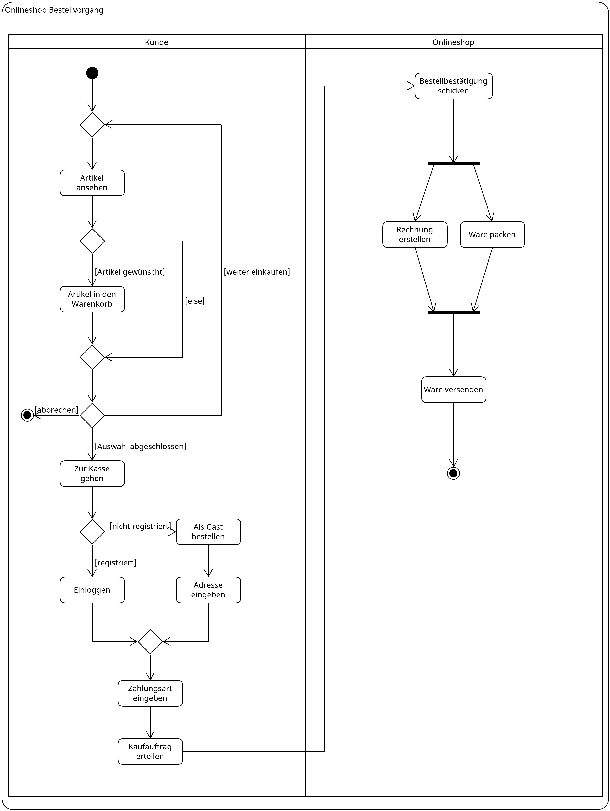
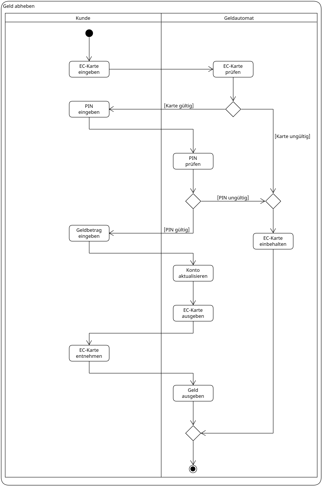
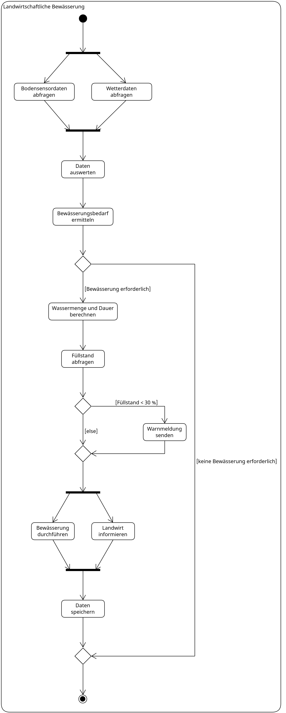
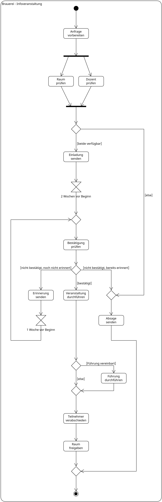

# Praxis mit Aktivitäts-Diagrammen

## 1. Prozess nach Rechnungseingang in der Buchhaltung

### Lösung zu 1

## 2. Onlineshop Activity

### Lösung zu 2

## 3. Fingerabdruck Recherche

### Lösung zu 3

## 4. EC-Automat

### Lösung zu 4

## 5. Bewässerungs-Steuerung

### Lösung zu 5

## 6. Brauerei-Informationsveranstaltung

### Lösung zu 6

