# Praxis mit Klassen-Diagrammen

## 1. Kunden in Geschäftsprozessen

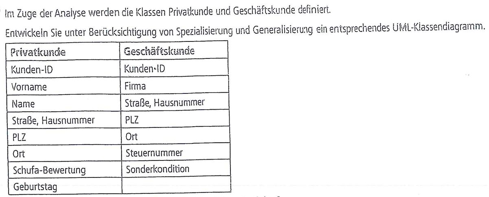

### Lösung zu 1

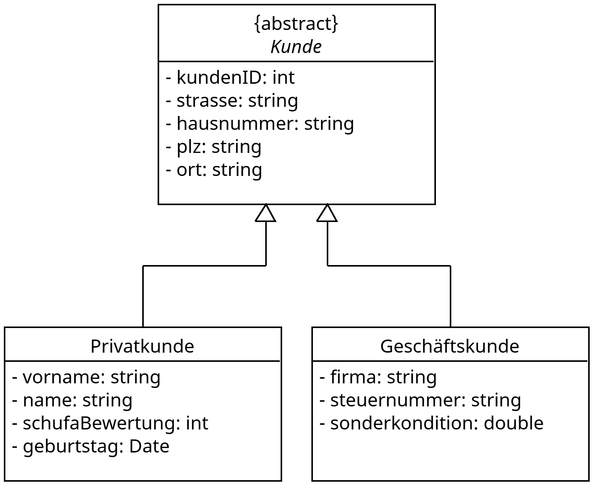

## 2. Begriffsklärung

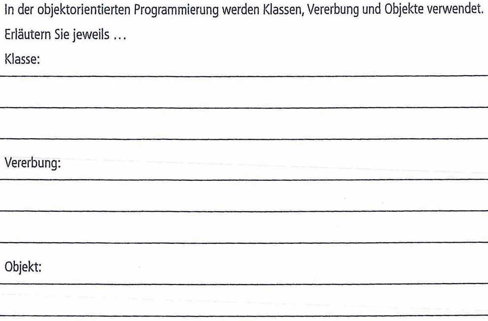

### Lösung zu 2

#### Klasse:
Eine Klasse ist ein Bauplan bzw. eine Vorlage für Objekte. Sie legt fest, welche Attribute (Eigenschaften) und Methoden (Verhalten) die Objekte dieser Klasse haben.

#### Vererbung:
Bei der Vererbung übernimmt eine Unterklasse alle Attribute und Methoden einer Oberklasse und kann diese um eigene erweitern oder überschreiben. So wird Code wiederverwendet und eine "ist-ein"-Beziehung abgebildet.

#### Objekt:
Ein Objekt ist eine konkrete Instanz einer Klasse, die zur Laufzeit erzeugt wird. Es besitzt eigene Attributwerte (Zustand) und kann die Methoden der Klasse ausführen.

[Binden Sie hier das PNG Ihrer Lösung ein.]

## 3. Vererbungsbaum für die Klasse *Getränk*

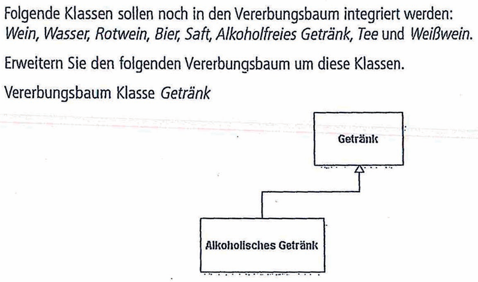

### Lösung zu 3

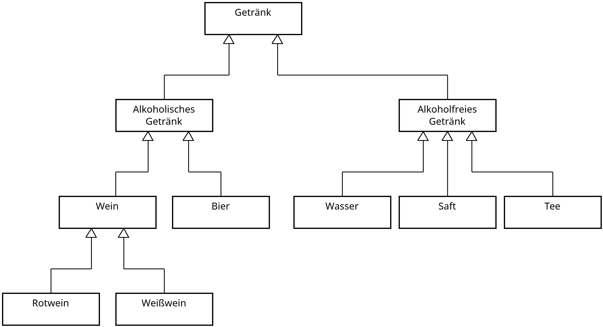

## 4. Beziehungen identifizieren und erklären

Für folgende drei Sätze, identifizieren Sie den passenden Beziehungstyp, begründen Sie Ihre Entscheidung und zeichnen Sie das Klassendiagramm. (Sie können die Lösungen zusammen in eine Datei zeichnen.)

A) Eine Immobilie besteht aus mehreren Wohnungen.

B) Bewohner können entweder Mieter oder Eigentümer sein.

C) In einer Mietervereinigung gibt es mehrere Mieter.

### Lösung zu 4

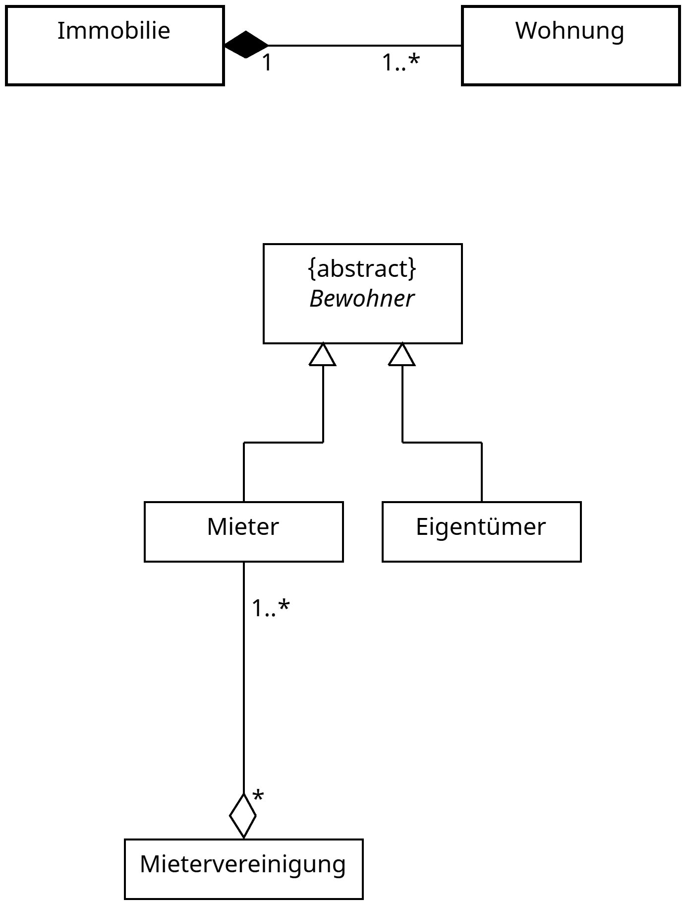

## 5. Kursverwaltung und Rechnungserstellung

Skizzieren Sie in UML-Notation die Beziehungen zwischen den Klassen. In der Darstellung der Klassen geben Sie nur die Klaasenbezeichnungen an. Begründen Sie in Stichworten die Auswahl der Beziehungstypen.

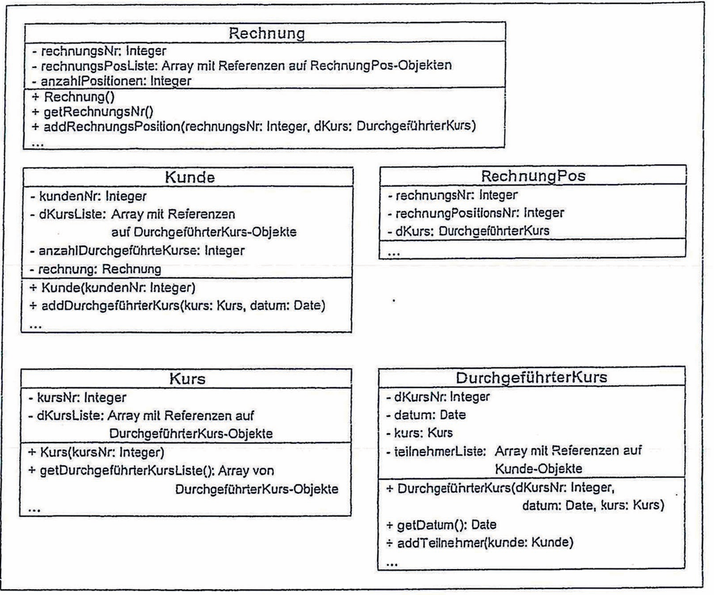

### Lösung zu 5

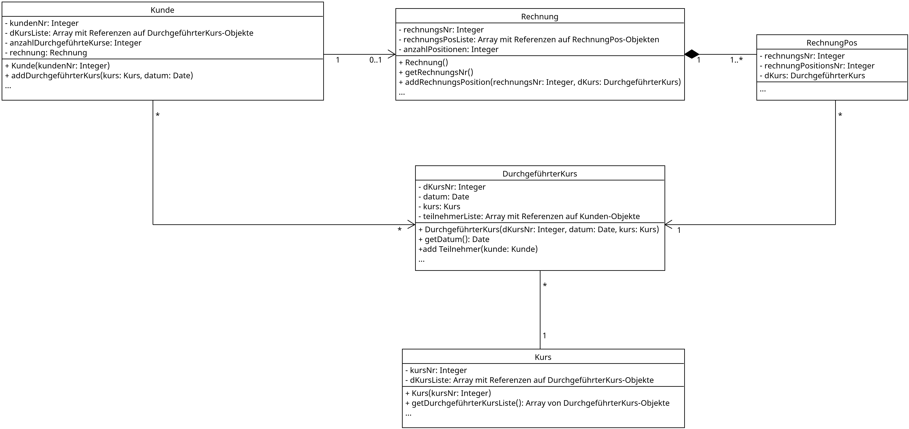

## 6. Programm zur Schadensregulierung bei einer Versicherungsgesellschaft

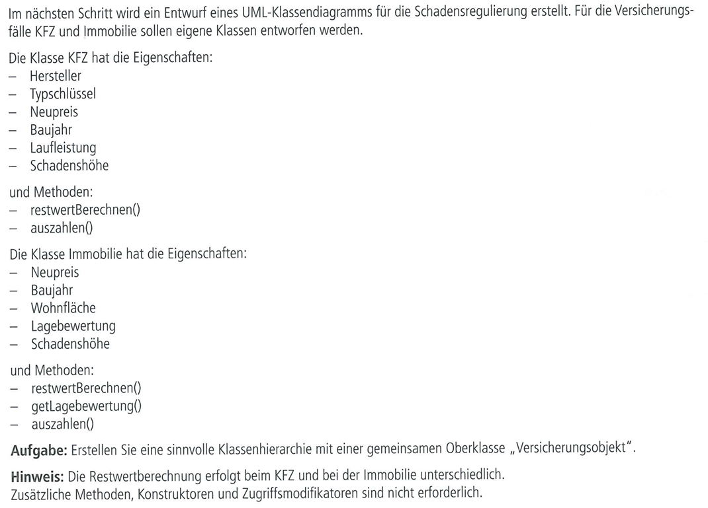

### Lösung zu 6

[Binden Sie hier das PNG Ihrer Lösung ein.]

## 7. Helferlein Verein: Proxy für Zugriff auf Mitglieder Bewertung

Diese Übung hat den gleichen Projektkontext wie Übung 1 der [Use-Case Übungen](../1-Use-Case/1-Use-Case-Praxis.md) und dient als Kontext für Übung 3 der [Sequence Übungen](../5-Sequence/5-Sequence-Praxis.md).

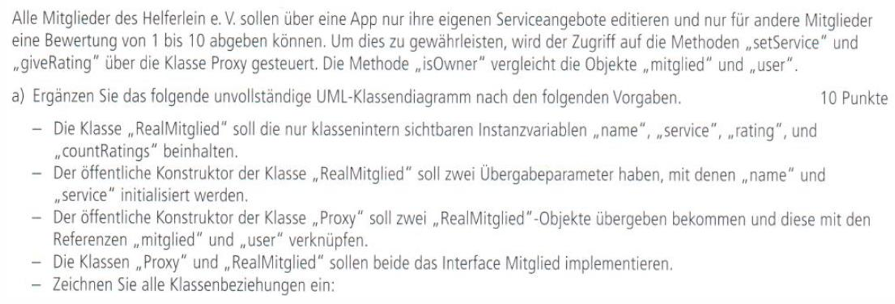

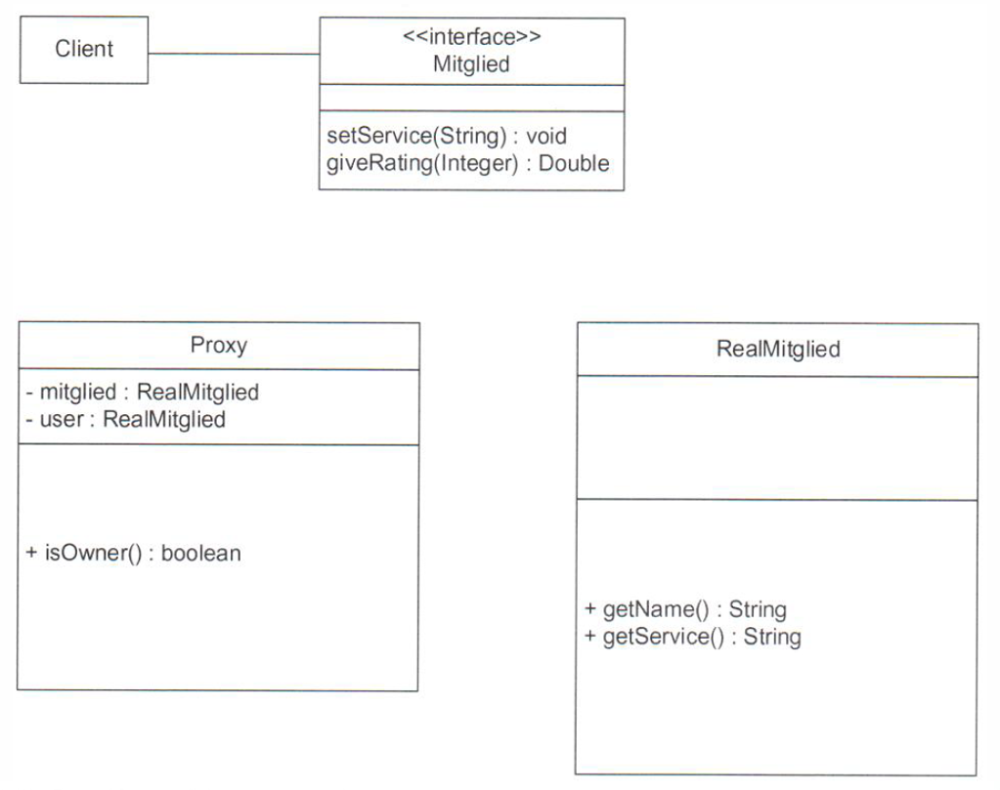

### Lösung zu 7

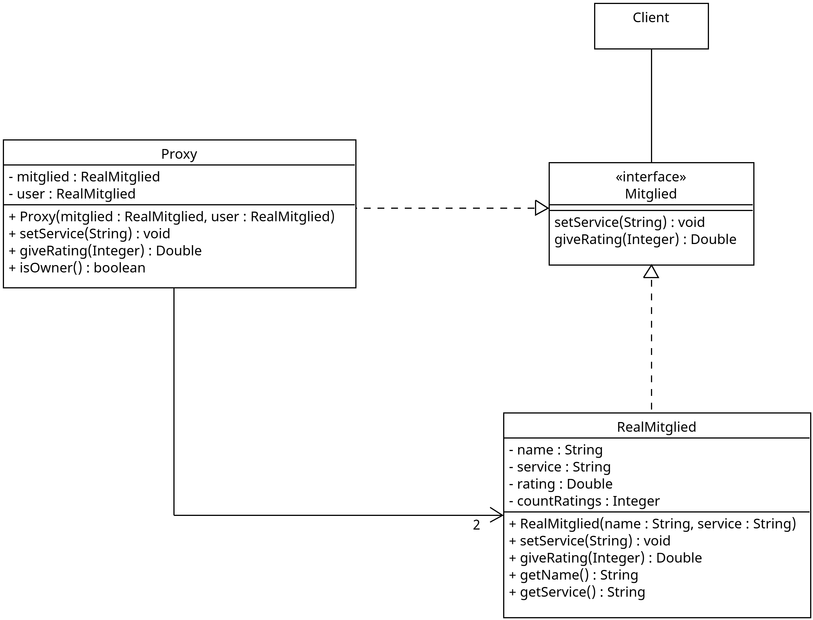

## 8. Leichtathletik Wettkämpfe

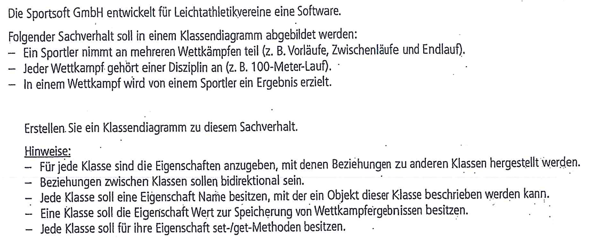

### Lösung zu 8

[Binden Sie hier das PNG Ihrer Lösung ein.]

## 9. Bioscan: Erfassung von Fingerabdrücken und Handabdrücken

[Schreiben Sie hier Ihre Beschreibungen zu Aufgabenteil a.]

### Lösung zu 9

[Binden Sie hier das PNG Ihrer Lösung ein.]

## 10. Schiffsreisen

### Lösung zu 10

[Binden Sie hier das PNG Ihrer Lösung ein.]
