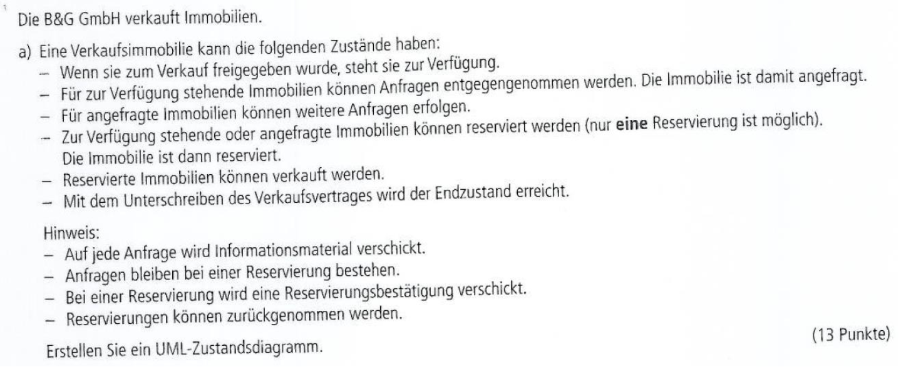

# Praxis mit Zustands-Diagrammen

## 1. Zustände eines Herz-Kreislauf-Trainingsgeräts

Folgende Zustände sind gegeben:

### Lösung zu 1

[Binden Sie hier das PNG Ihrer Lösung ein.]

## 2. Zustände eines E-Bike-Ladegeräts

### Lösung zu 2

[Binden Sie hier das PNG Ihrer Lösung ein.]

## 3. Zustände im Immobilienverkaufs

### Lösung zu 3

[Binden Sie hier das PNG Ihrer Lösung ein.]

## 4. Gebäude-Lichtsteuerungssystem

- Beachten Sie einen möglichen Widerspruch in der Aufgabenstellung.
- Sie können optional Zustände mit internen Verhalten verwenden.

### Lösung zu 4

[Binden Sie hier das PNG Ihrer Lösung ein.]

## 5. Buchungssystem für Zeitfenster in einem Impfzentrum

### Lösung zu 5

[Binden Sie hier das PNG Ihrer Lösung ein.]
