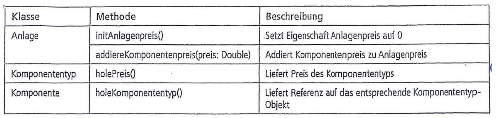
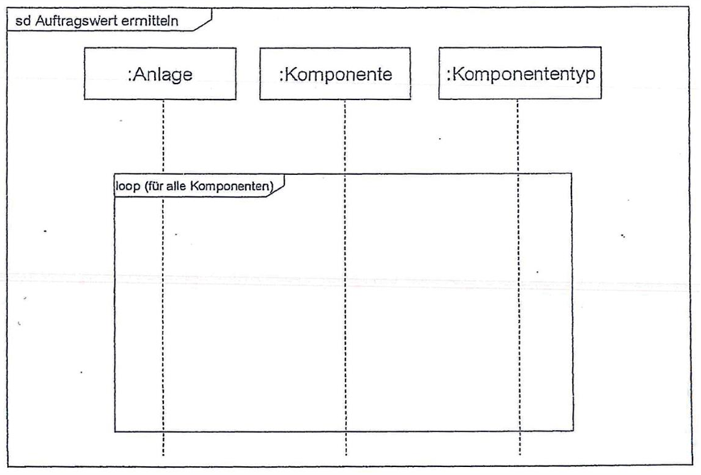
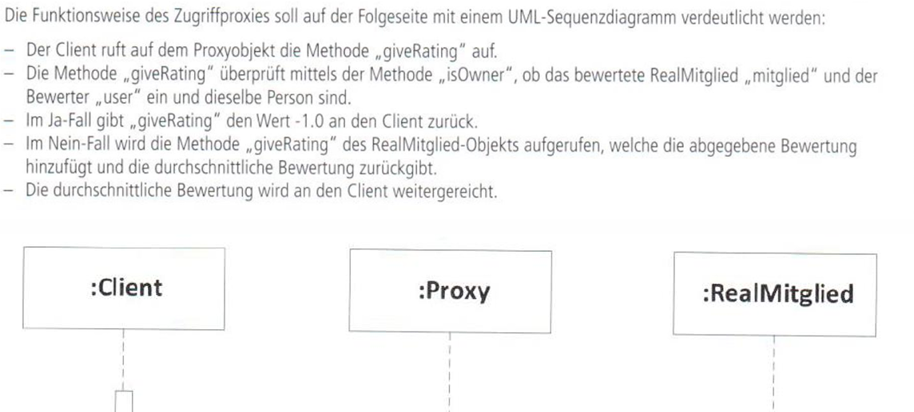

# Praxis mit Sequenz-Diagrammen

## 1. Steuerung eines Herz-Kreislauf-Trainingsgeräts

Diese Aufgabe ergänzt Aufgabe 1 der [Aufgaben zu Zustandsdiagrammen](../4-State/4-State-Praxis.md)

Folgende Akteure sind gegeben:

### Lösung zu 1

[Binden Sie hier das PNG Ihrer Lösung ein.]

## 2. Auftragswert einer Solaranlage berechnen

Folgende Klassen sind gegeben. Erstellen Sie zu dieser Abbildung zunächst ein Klassendiagramm.

Aufgabenstellung für das Sequenzdiagramm:

Folgender Aufbau ist für das Sequenzdiagramm vorgegeben:

### Lösung zu 2

[Binden Sie hier das PNG Ihrer Lösung ein.]

## 3. Mitglieder Bewertung für den Helferlein-Verein

Diese Aufgabe steht im gleichen Projektkontext wie Aufgabe 6 der [Use-Case Übungen](../1-Use-Case/1-Use-Case-Praxis.md).

Der Zusammenhang zwischen den Klassen Client, Proxy und Realmitglied wurde in einer [Klassendiagramm-Übung](../3-Class/3-Class-Praxis.md) betrachtet.

### Lösung zu 3

[Binden Sie hier das PNG Ihrer Lösung ein.]
