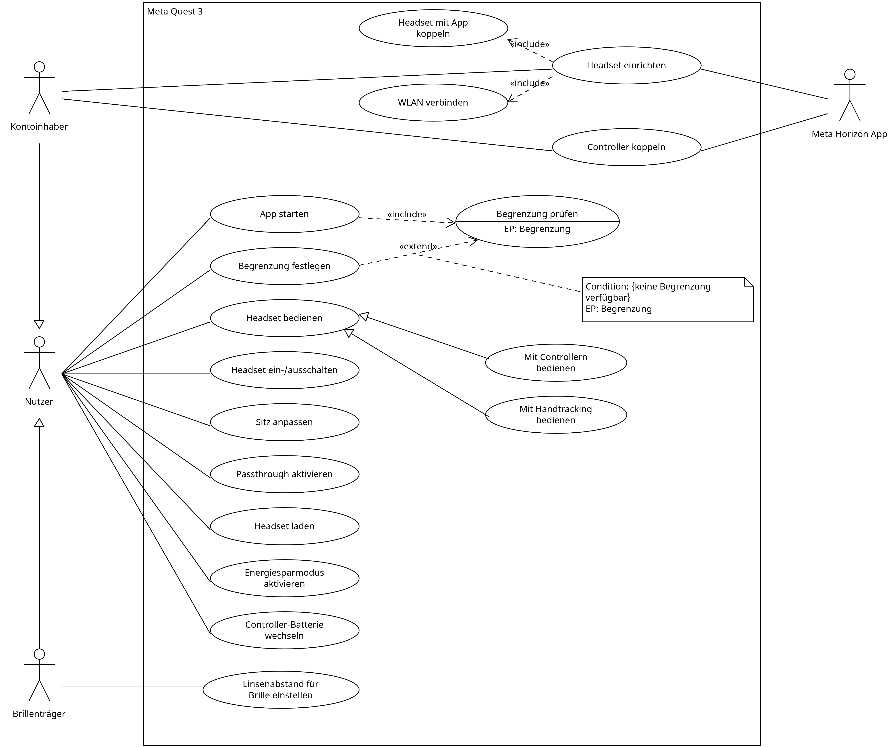

# Use-Case-Diagramm

## Kurze Zusammenfassung des Diagramminhalts

Das Diagramm zeigt, welche Funktionen die Meta Quest 3 ihren Nutzerinnen und Nutzern
bietet und wer daran beteiligt ist. Betrachtet werden die Einrichtung des Headsets mit
der Meta Horizon-App, die Kopplung der Controller, die Bedienung, die Begrenzung des
Spielbereichs sowie alltägliche Funktionen wie Laden, Passthrough und Energiesparmodus.

## Diagramm

## Beschreibungstext

Die Meta Quest 3 wird von verschiedenen Personen genutzt. Jeder Nutzer kann das Headset
ein- und ausschalten, den Sitz anpassen, das Headset laden, den Passthrough aktivieren,
um die reale Umgebung zu sehen, und bei Bedarf in den Energiesparmodus wechseln, um die
Akkulaufzeit zu verlängern. Wenn die Batterien der Controller leer sind, kann er sie
selbst wechseln. Bedient wird das Headset entweder mit den Touch Plus-Controllern oder
ganz ohne Controller über das Handtracking, bei dem die Brille die Bewegungen der Hände
erkennt.

Eine besondere Rolle hat der Kontoinhaber. Er kann alles, was jeder andere Nutzer auch
kann, richtet das Headset aber zusätzlich erstmalig ein und koppelt die Controller.
Dafür benötigt er die Meta Horizon-App auf seinem Smartphone, die bei diesen beiden
Vorgängen beteiligt ist. Zur Einrichtung gehört immer, dass das Headset mit der App
gekoppelt und mit dem WLAN verbunden wird.

Auch Brillenträger können die Meta Quest 3 wie jeder andere Nutzer verwenden. Für sie
gibt es die zusätzliche Möglichkeit, den Abstand der Linsen zum Gesicht zu vergrößern,
damit die eigene Brille unter dem Headset Platz hat.

Ein wichtiger Sicherheitsaspekt ist die Begrenzung des Spielbereichs. Jedes Mal, wenn
eine Anwendung gestartet wird, prüft das Headset, ob für die Umgebung eine Begrenzung
vorhanden ist. Ist das nicht der Fall, wird der Nutzer aufgefordert, eine Begrenzung
festzulegen, bevor es weitergeht. Unabhängig davon kann der Nutzer die Begrenzung auch
jederzeit selbst über die Einstellungen festlegen oder ändern.

Bewusst nicht betrachtet werden die Inhalte der Anwendungen selbst, also Spiele und der
Store, da sie nicht zur Bedienung des Geräts gehören.