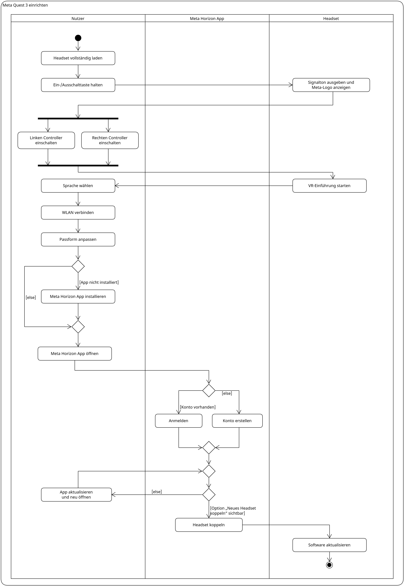
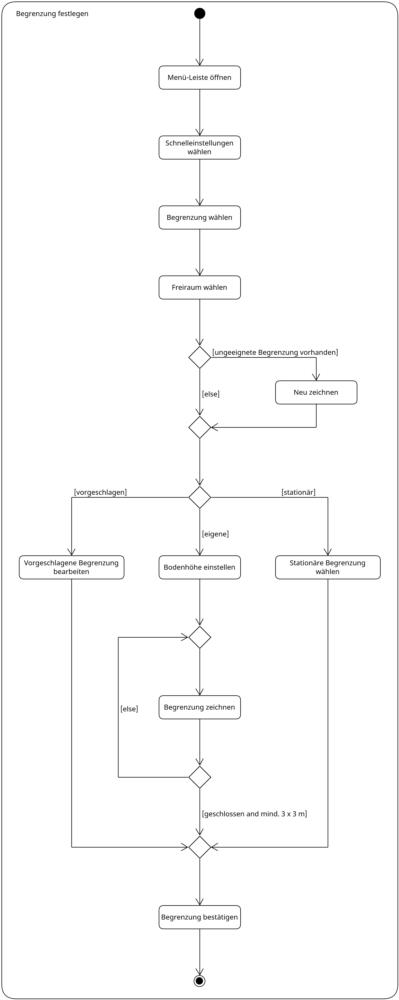

# Activity-Diagramm

## Kurze Zusammenfassung des Diagramminhalts

Die beiden Aktivitätsdiagramme zeigen zwei zentrale Abläufe bei der Inbetriebnahme der
Meta Quest 3. Das erste Diagramm beschreibt die Ersteinrichtung vom Aufladen bis zum
ersten Software-Update. Die drei Spalten zeigen, welche Schritte der Nutzer selbst
ausführt, welche in der Meta Horizon-App stattfinden und welche das Headset übernimmt.
Das zweite Diagramm zeigt, wie der Nutzer im Headset eine Begrenzung für seinen
Spielbereich festlegt.

## 1. Ersteinrichtung

### Diagramm

### Beschreibungstext

Bevor die Meta Quest 3 zum ersten Mal genutzt wird, lädt der Nutzer das Headset
vollständig auf. Anschließend hält er die Ein-/Ausschalttaste gedrückt, bis das Headset
mit einem Signalton startet und das Meta-Logo anzeigt. Danach schaltet der Nutzer die
beiden Controller ein. Die Reihenfolge spielt dabei keine Rolle, der linke und der
rechte Controller können auch gleichzeitig eingeschaltet werden. Erst wenn beide bereit
sind, geht es weiter.

Das Headset startet nun die VR-Einführung. Der Nutzer wählt die Sprache, verbindet das
Headset mit dem WLAN und passt die Passform an seinen Kopf an. Ist die Meta Horizon-App
noch nicht auf seinem Smartphone vorhanden, installiert er sie zunächst. Anschließend
öffnet er die App. Hat er bereits ein Meta-Konto, meldet er sich an, andernfalls
erstellt er ein neues Konto. Danach geht es in beiden Fällen auf dieselbe Weise weiter.

Um das Headset zu koppeln, benötigt der Nutzer in der App die Option „Neues Headset
koppeln“. Fehlt diese Option, muss er die App aktualisieren, schließen und neu öffnen.
Das wiederholt er so lange, bis die Option angezeigt wird. Dann wird das Headset über
die App gekoppelt. Zum Abschluss aktualisiert das Headset seine Software, und die
Einrichtung ist beendet.

## 2. Begrenzung festlegen

### Diagramm

### Beschreibungstext

Damit der Nutzer sich in VR sicher bewegen kann, legt er eine Begrenzung für seinen
Spielbereich fest. Dazu öffnet er im Headset die Menü-Leiste, wählt die
Schnelleinstellungen und darin den Punkt „Begrenzung“. Anschließend wählt er den
Freiraum aus. Ist bereits eine Begrenzung vorhanden, die nicht zum aktuellen Raum
passt, entscheidet er sich, sie neu zu zeichnen. Danach geht es in beiden Fällen gleich
weiter.

Nun hat der Nutzer drei Möglichkeiten. Er kann die vom Headset vorgeschlagene
Begrenzung übernehmen und bei Bedarf bearbeiten. Er kann eine eigene Begrenzung
anlegen: Dafür stellt er zuerst die Bodenhöhe ein und zeichnet dann mit dem Controller
die Grenze seines Spielbereichs. Ist die Begrenzung noch nicht geschlossen oder kleiner
als 3 x 3 Meter, zeichnet er sie erneut, bis sie beide Bedingungen erfüllt. Die dritte
Möglichkeit ist, statt einer selbst gezeichneten eine stationäre Begrenzung zu nutzen.

Welchen Weg der Nutzer auch gewählt hat, zum Schluss bestätigt er die Begrenzung, und
der Spielbereich ist eingerichtet.