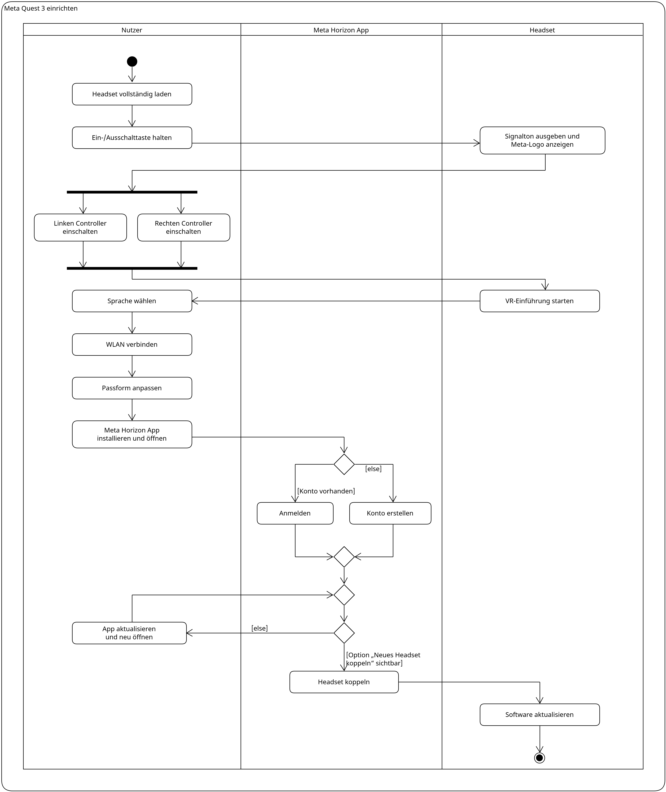

# Activity-Diagramm

## Kurze Zusammenfassung des Diagramminhalts

Das Diagramm zeigt den Ablauf der Ersteinrichtung der Meta Quest 3 vom Aufladen bis zum
ersten Software-Update. Die drei Spalten zeigen, welche Schritte der Nutzer selbst
ausführt, welche in der Meta Horizon-App stattfinden und welche das Headset übernimmt.

## Diagramm

## Beschreibungstext

Bevor die Meta Quest 3 zum ersten Mal genutzt wird, lädt der Nutzer das Headset
vollständig auf. Anschließend hält er die Ein-/Ausschalttaste gedrückt, bis das Headset
mit einem Signalton startet und das Meta-Logo anzeigt. Danach schaltet der Nutzer die
beiden Controller ein. Dabei spielt die Reihenfolge keine Rolle, der linke und der
rechte Controller können auch gleichzeitig eingeschaltet werden. Erst wenn beide bereit
sind, geht es weiter.

Das Headset startet nun die VR-Einführung. Der Nutzer wählt die Sprache, verbindet das
Headset mit dem WLAN und passt die Passform an seinen Kopf an. Danach installiert er die
Meta Horizon-App auf seinem Smartphone und öffnet sie. Hat er bereits ein Meta-Konto,
meldet er sich an, andernfalls erstellt er ein neues Konto. In beiden Fällen geht es
anschließend gleich weiter.

Um das Headset zu koppeln, benötigt der Nutzer in der App die Option „Neues Headset
koppeln“. Fehlt diese Option, muss er die App aktualisieren, schließen und neu öffnen.
Das wiederholt er so lange, bis die Option angezeigt wird. Dann wird das Headset über
die App gekoppelt. Zum Abschluss aktualisiert das Headset seine Software, und die
Einrichtung ist beendet.