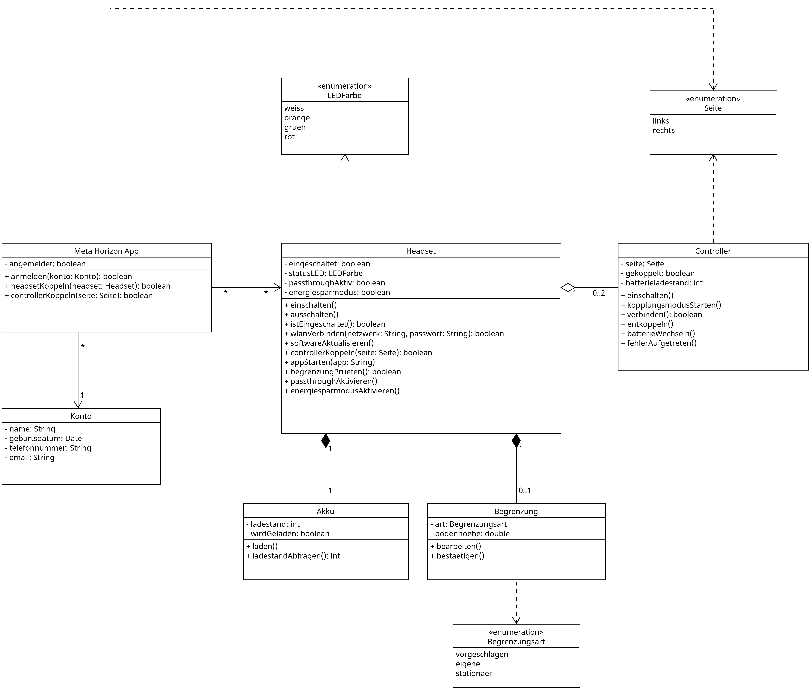

# Class-Diagramm

## Kurze Zusammenfassung des Diagramminhalts

Das Diagramm zeigt, aus welchen Bestandteilen das System Meta Quest 3 besteht, welche
Eigenschaften diese haben, welche Funktionen sie anbieten und wie sie miteinander
zusammenhängen.

## Diagramm

## Beschreibungstext

Im Mittelpunkt steht das Headset. Es weiß, ob es eingeschaltet ist, welche Farbe seine
Status-LED gerade zeigt und ob Passthrough oder der Energiesparmodus aktiv sind. Über
das Headset werden die wichtigsten Funktionen ausgelöst: ein- und ausschalten, mit dem
WLAN verbinden, die Software aktualisieren, Controller koppeln, Anwendungen starten,
die Begrenzung prüfen sowie Passthrough und Energiesparmodus aktivieren.

Jedes Headset besitzt genau einen Akku. Da der Akku fest eingebaut ist, gehört er
untrennbar zu seinem Headset und kann ohne dieses nicht genutzt werden. Der Akku kennt
seinen Ladestand und weiß, ob er gerade geladen wird. Ebenso fest zum Headset gehört
die Begrenzung des Spielbereichs. Direkt nach dem Auspacken gibt es noch keine
Begrenzung, später höchstens eine. Sie kann vom Headset vorgeschlagen, selbst
gezeichnet oder als stationäre Begrenzung genutzt werden und lässt sich bearbeiten und
bestätigen.

Mit einem Headset können bis zu zwei Controller gekoppelt sein, einer für die linke und
einer für die rechte Hand. Anders als der Akku sind die Controller eigenständige
Geräte: Sie können entkoppelt und neu gekoppelt werden. Jeder Controller kennt seine
Seite, weiß, ob er gekoppelt ist, und kennt den Ladestand seiner Batterie. Er kann
eingeschaltet werden, in den Kopplungsmodus wechseln, sich mit dem Headset verbinden
und einen Fehler melden. Seine Batterie kann gewechselt werden.

Die Meta Horizon-App auf dem Smartphone ist mit genau einem Meta-Konto angemeldet, für
das Name, Geburtsdatum, Telefonnummer und E-Mail-Adresse hinterlegt sind. Über die App
werden Headsets und Controller gekoppelt.

Die festen Auswahlmöglichkeiten des Systems sind als Aufzählungen dargestellt: die
Farben der Status-LED (weiß, orange, grün, rot), die Arten der Begrenzung und die
beiden Seiten der Controller.