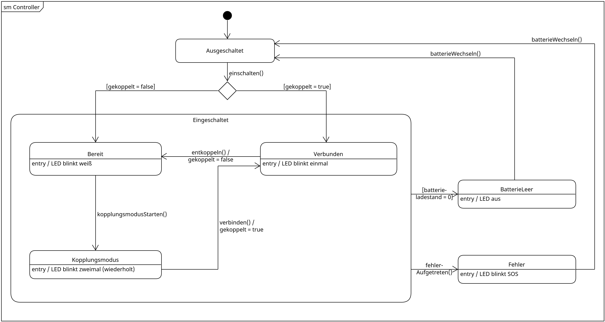

# State-Diagramm

## Kurze Zusammenfassung des Diagramminhalts

Das Diagramm zeigt, in welchen Zuständen sich ein Touch Plus-Controller befinden kann,
wodurch er von einem Zustand in den nächsten wechselt und wie er seinen jeweiligen
Zustand über seine LED anzeigt.

## Diagramm

## Beschreibungstext

Zu Beginn ist der Controller ausgeschaltet. Wird er eingeschaltet, hängt es davon ab,
ob er bereits mit dem Headset gekoppelt ist. Ist er noch nicht gekoppelt, ist er
zunächst nur bereit und zeigt dies durch weißes Blinken an. Ist er bereits gekoppelt,
verbindet er sich automatisch mit dem Headset.

Aus dem bereiten Zustand kann der Nutzer den Kopplungsmodus starten, indem er die
entsprechenden Tasten gedrückt hält. Im Kopplungsmodus blinkt die LED wiederholt
zweimal. Sobald die Verbindung mit dem Headset hergestellt ist, gilt der Controller
als gekoppelt und ist verbunden, was die LED durch einmaliges Blinken anzeigt. Wird der
Controller wieder entkoppelt, kehrt er in den bereiten Zustand zurück.

Solange der Controller eingeschaltet ist, also egal ob er gerade bereit, im
Kopplungsmodus oder verbunden ist, können zwei Situationen eintreten. Ist die Batterie
leer, erlischt die LED und der Controller kann nicht mehr verwendet werden. Tritt ein
Fehler auf, zeigt die LED ein SOS-Signal. In beiden Fällen hilft es, die Batterie
herauszunehmen und wieder einzusetzen bzw. durch eine neue zu ersetzen. Danach ist der
Controller wieder ausgeschaltet und kann erneut gestartet werden.