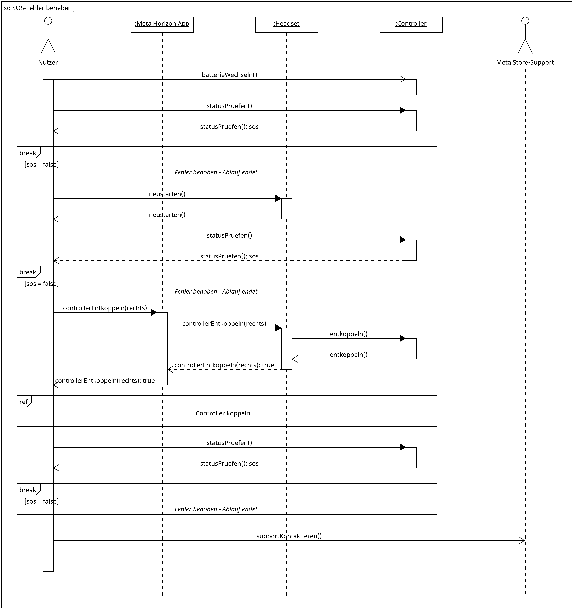

# Sequence-Diagramme

Zu diesem Diagrammtyp haben wir zwei Diagramme erstellt: die Kopplung eines Controllers
und die Behebung eines SOS-Fehlers am Controller. Das zweite Diagramm greift auf das
erste zurück.

## 1. Controller koppeln

### Kurze Zusammenfassung des Diagramminhalts

Das Diagramm zeigt, wie der Kontoinhaber einen Controller über die Meta Horizon-App mit
dem Headset koppelt und welche Nachrichten dabei zwischen App, Headset und Controller
ausgetauscht werden.

### Diagramm

### Beschreibungstext

Der Kontoinhaber wählt in der Meta Horizon-App aus, dass er einen Controller, hier den
rechten, koppeln möchte. Die App fragt zuerst beim Headset nach, ob es eingeschaltet
ist, denn nur dann kann die Kopplung gelingen.

Ist das Headset eingeschaltet, beauftragt die App das Headset, den Controller zu
koppeln. Der Kontoinhaber hält nun am Controller die vorgesehenen Tasten gedrückt,
wodurch der Controller in den Kopplungsmodus wechselt. Darauf muss er nicht warten,
er drückt nur die Tasten. Das Headset nimmt daraufhin die Verbindung zum Controller
auf, und der Controller bestätigt die erfolgreiche Verbindung. Das Headset meldet der
App, dass die Kopplung geklappt hat, und die App zeigt dem Kontoinhaber das Ergebnis
an.

Ist das Headset dagegen nicht eingeschaltet, findet keine Kopplung statt. Die App
teilt dem Kontoinhaber direkt mit, dass der Controller nicht gekoppelt werden konnte.

## 2. SOS-Fehler beheben

### Kurze Zusammenfassung des Diagramminhalts

Das Diagramm zeigt, wie der Kontoinhaber einen Fehler am Controller behebt, der durch
ein SOS-Blinksignal der LED angezeigt wird. Die Schritte werden nacheinander
ausgeführt, bis der Fehler behoben ist.

### Diagramm

### Beschreibungstext

Blinkt die LED eines Controllers im SOS-Rhythmus, liegt ein Fehler vor. Der
Kontoinhaber nimmt zuerst die Batterie aus dem Controller und setzt sie wieder ein.
Anschließend prüft er, ob die LED weiterhin SOS anzeigt. Ist der Fehler verschwunden,
ist er behoben und es sind keine weiteren Schritte nötig.

Blinkt die LED weiterhin SOS, startet der Kontoinhaber das Headset neu und prüft den
Controller erneut. Auch hier endet der Ablauf, sobald der Fehler nicht mehr
auftritt.

Hilft auch das nicht, entkoppelt der Kontoinhaber den Controller über die Meta
Horizon-App. Die App gibt den Auftrag an das Headset weiter, das die Verbindung zum
Controller trennt und den Erfolg zurückmeldet. Danach koppelt der Kontoinhaber den
Controller neu. Dieser Vorgang läuft genauso ab wie im ersten Sequenzdiagramm
beschrieben und wird hier deshalb nur als Verweis dargestellt. Ist der Fehler danach
behoben, endet der Ablauf.

Besteht der Fehler weiterhin, wendet sich der Kontoinhaber an den Meta Store-Support.
Die Bedienungsanleitung nennt vor diesem letzten Schritt noch die Prüfung auf
Software-Updates und einen erzwungenen Neustart. Diese beiden Schritte haben wir der
Übersichtlichkeit halber nicht dargestellt.